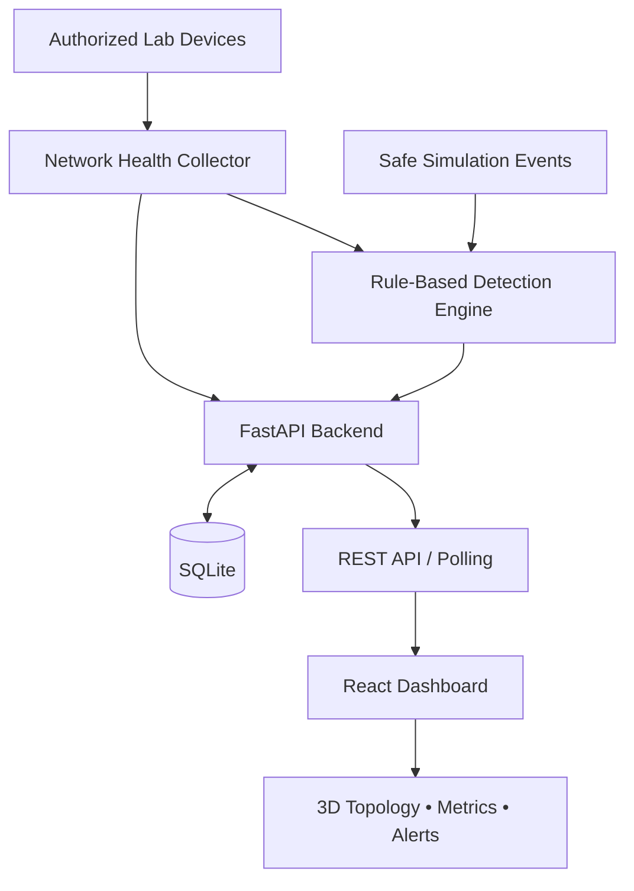

<div align="center">

# 🛡️ NetGuard 3D

### Interactive 3D Network Monitoring & Cyber Threat Detection

**See your network. Understand its health. Investigate suspicious activity.**


*A CSNE + Cybersecurity team project*

</div>

---

## ✨ Project Overview

**NetGuard 3D** is a web-based dashboard that combines **real network health monitoring** with **simulated cybersecurity events**. It presents network devices as an interactive 3D map, so users can explore connections, check device health, and investigate security alerts from one place.

Our goal is to create a **small, complete, working prototype in 14 days**—not a full enterprise security platform.

> **Important:** Real monitoring uses authorized lab devices. Security simulations use clearly labeled test events. A simulated alert is not proof of a real attack.

## 🎯 What Will the App Do?

Imagine a small lab with a router, a server, and several computers.

1. The **network monitoring engine** checks whether known devices can be reached and measures their response times.
2. The **3D dashboard** shows devices and connections. Users can rotate, zoom, and click a device for details.
3. The **simulation engine** generates safe example events, such as a traffic spike or an unusual connection pattern.
4. The **detection engine** checks events against rules and creates alerts when needed.
5. The dashboard **highlights the affected device** and shows the alert history.
6. Users can **export alerts as CSV** for review.

## 🚀 Core Features

| Feature | What users will see | Data source |
|:--|:--|:--|
| 🌐 **Interactive 3D Map** | Rotate, zoom, and select routers, servers, and computers | Device inventory and topology |
| 📡 **Network Health** | Device reachability and latency | **Real** authorized checks |
| 📊 **Network Statistics** | Availability and latency trends; traffic charts **only where telemetry is available** | Real measurements / labeled sample data |
| 🛡️ **Rule-Based Detection** | Alerts for configured suspicious event patterns | Simulated events initially |
| 🧪 **Threat Simulation** | Traffic spike, unusual connections, device-offline scenario | **Simulation** |
| 🔔 **Alerts & Reports** | Severity, affected device, alert history, CSV export | Detection results |

### 🎨 Planned Dashboard Layout

```text
┌──────────────────────────────────────────────────────────────────────────┐
│  🛡️ NETGUARD 3D                 REAL / SIMULATED              STATUS    │
├──────────────────┬────────────────────────────────┬─────────────────────┤
│ NETWORK HEALTH   │       INTERACTIVE 3D MAP       │  SECURITY ALERTS    │
│                  │                                │                     │
│ • Online devices │     Router ─── Switch          │ • Alert severity    │
│ • Reachability   │                 │              │ • Affected device   │
│ • Latency        │       Server ─── PC            │ • Event source      │
│ • Trends         │                                │ • Incident details  │
├──────────────────┴────────────────────────────────┴─────────────────────┤
│                 METRICS • EVENT HISTORY • CSV EXPORT                   │
└──────────────────────────────────────────────────────────────────────────┘
```

*This is a wireframe, not a screenshot of a finished dashboard.*

## 🏗️ System Architecture



**How data moves:** authorized device checks and simulation events enter the Python backend. The backend stores measurements and alerts in SQLite and exposes them through APIs. React displays the latest information in the dashboard.

**Data honesty:** every displayed event should carry a `source` value such as `real` or `simulation`. The 3D view must show that distinction clearly.

## 👥 Team & Responsibilities

Both students own major technical modules and share integration, testing, and documentation.

| **Student 1 — CSNE (50%)** | **Student 2 — Cybersecurity (50%)** |
|:--|:--|
| Network device inventory | Security detection rules |
| Authorized device health checks | Simulated security event generator |
| Latency and reachability metrics | Event analysis and severity levels |
| Network topology data | Threat colors / overlays in the 3D map |
| Interactive 3D visualization | Alert history and incident details |
| Network statistics and charts | Security CSV reports |

**Shared tasks:** API contracts, database integration, GitHub workflow, end-to-end testing, final demo, and README/docs.

## 🧰 Technology Stack

| Area | Tools |
|:--|:--|
| Frontend | React + Vite |
| 3D graphics | Three.js, React Three Fiber, Drei |
| Charts | Recharts |
| Backend | Python, FastAPI |
| Database | SQLite |
| Updates | REST API with short polling (first version) |
| Monitoring | Python network health checks |
| Detection | Python rule-based engine |
| Collaboration | Git + GitHub |

## 📁 Project Structure

```text
NetGuard-3D/
├── frontend/
│   └── src/
│       ├── components/        # 3D map, charts, alerts
│       ├── services/          # API communication
│       └── App.jsx
├── backend/
│   ├── main.py                # FastAPI application
│   ├── network/
│   │   ├── monitor.py         # Device health checks
│   │   └── devices.py         # Device inventory
│   ├── security/
│   │   ├── detector.py        # Detection rules
│   │   └── simulator.py       # Safe simulated events
│   └── database/
│       └── db.py              # SQLite access
├── docs/
│   ├── architecture.md
│   ├── security-requirements.md
│   └── threat-scenarios.md
├── .gitignore
└── README.md
```

*Some files and folders may be added during development.*

## ⚙️ Getting Started (Windows / PowerShell)

### Prerequisites

- Git
- Node.js and npm
- Python 3.10+
- VS Code (recommended)

### 1. Clone the repository

```powershell
git clone https://github.com/YOUR_USERNAME/NetGuard-3D.git
cd NetGuard-3D
```

Replace `YOUR_USERNAME` with your repository owner's username.

### 2. Start the backend

Open a PowerShell terminal in the project root:

```powershell
cd backend
python -m venv .venv
.\.venv\Scripts\python.exe -m pip install fastapi "uvicorn[standard]" ping3
.\.venv\Scripts\python.exe -m uvicorn main:app --reload
```

- API base: `http://127.0.0.1:8000`
- API documentation: `http://127.0.0.1:8000/docs`

### 3. Start the frontend

Open a **second** terminal in the project root:

```powershell
cd frontend
npm install
npm run dev
```

Open the URL shown by Vite (usually `http://localhost:5173`).

> These steps assume the React/Vite starter and FastAPI `main.py` have already been initialized. They do **not** mean that every planned dashboard feature is implemented yet.

## 🔌 Planned API Endpoints

| Method | Endpoint | Purpose |
|:--|:--|:--|
| `GET` | `/api/health` | Check backend status |
| `GET` | `/api/devices` | List monitored devices |
| `GET` | `/api/network/topology` | Get devices and links |
| `GET` | `/api/network/stats` | Get network health metrics |
| `GET` | `/api/alerts` | View security alerts |
| `POST` | `/api/simulation/start` | Generate a safe test scenario |
| `GET` | `/api/reports/alerts.csv` | Export alert history |

**Development note:** endpoints other than the starter health route are planned until their code is completed.

## 📅 14-Day Development Plan

| Day | CSNE Student | Cybersecurity Student |
|:--:|:--|:--|
| **1** | Architecture, GitHub, UI wireframe | Threat scenarios, requirements |
| **2** | Device inventory, health checker | Event format, security rules |
| **3** | Reachability and latency collection | Detection engine |
| **4** | Network status APIs | Alert APIs |
| **5** | 3D devices and connections | Threat status overlay |
| **6** | Device details and live refresh | Alert notifications |
| **7** | Validate monitoring prototype | Validate detection prototype |
| **8** | Metrics charts | Traffic-spike simulation |
| **9** | 3D interaction polish | Alert severity and details |
| **10** | Device health history | Alert history and CSV export |
| **11** | Network/API integration tests | Detection integration tests |
| **12** | Responsive UI and error states | Alert panel UX |
| **13** | Reliability and performance tests | Rule accuracy and false-alert tests |
| **14** | Network documentation and demo | Security documentation and demo |

## 🎬 Final Demonstration

**Scenario 1 — Real Monitoring:** Show a lab device's reachability and latency in the 3D map.

**Scenario 2 — Simulation:** Trigger a labeled traffic-spike event from the dashboard.

**Scenario 3 — Detection:** Show the rule that triggered an alert, including severity and affected device.

**Scenario 4 — Visualization:** Highlight the affected device in the 3D network view.

**Scenario 5 — Reporting:** Open alert history and export a CSV report.

## ✅ Definition of Done

- [ ] 3D map supports rotate, zoom, and device selection.
- [ ] At least 2–3 authorized devices/endpoints are monitored reliably.
- [ ] Device status and latency refresh correctly.
- [ ] Three safe simulation scenarios are available.
- [ ] Rules produce understandable, correctly labeled alerts.
- [ ] Alert history is saved and can be exported to CSV.
- [ ] Real and simulated data are clearly identified.
- [ ] Network failures and API errors do not crash the dashboard.
- [ ] Both students have tested and documented their modules.
- [ ] README, architecture diagram, and demo steps are complete.

## 🔐 Responsible Use & Limitations

- Monitor **only networks and devices you own or are authorized to test**.
- Use simulations in an isolated or controlled lab.
- An unanswered health check may mean **unreachable**, not definitely powered off.
- A rule-based alert indicates **something worth investigating**, not a confirmed cyberattack.
- Packet-level traffic charts require an actual source of traffic telemetry; latency alone cannot provide bandwidth measurements.

## 🔮 Possible Future Improvements

Machine-learning anomaly detection, richer packet/flow telemetry, automatic topology discovery, role-based access control, and container-based deployment.

---

<div align="center">

**Built as a joint CSNE + Cybersecurity learning project.**

*NetGuard 3D — Make network activity easier to see and understand.*

</div>
